# BÁO CÁO BÀI TẬP THỰC HÀNH LẬP TRÌNH C# WINFORMS

## I. THÔNG TIN SINH VIÊN
- **Họ và tên:** Nguyễn Vũ Nhật Minh
- **Mã số sinh viên:** 24810320314
- **Lớp học phần:** Lập trình .NET - Mã Lớp: 010100475509
- **Link Repository:** https://github.com/minhnvn24810320314/NGUYEN-VU-NHAT-MINH_24810320314.git

---

## II. DANH SÁCH BÀI TẬP HOÀN THÀNH & TỰ ĐÁNH GIÁ

| Bài tập | Tiêu đề bài tập | Trạng thái | Mức độ hoàn thành (%) |
| :---: | :--- | :---: | :---: |
| **Bài 1** | Quản lý Đặt Phòng Khách Sạn | Hoàn thành | 100% |
| **Bài 2** | Quản lý Hồ Sơ Nhân Sự & Thông Tin Lương | Hoàn thành | 100% |
| **Bài 3** | Hệ Thống MDI Quản Lý Trường Học & Đào Tạo | Hoàn thành | 100% |
| **Bài 4** | Thống Kê Kho Hàng Async/Await & Cancellation | Hoàn thành | 100% |
| **Bài 5** | Giám Sát Thiết Bị IoT Real-time & Cross-Thread | Hoàn thành | 100% |

---

## III. MINH HỌA GIAO DIỆN & KỸ THUẬT NỔI BẬT

### 1. Bài 1: Quản lý Đặt Phòng Khách Sạn
- **Kỹ thuật áp dụng:** Khởi tạo giao diện bằng code C#, Data Binding hai chiều với `BindingList<T>` & `BindingSource`, xử lý tính toán chi phí tự động trên DataGridView, validation dữ liệu.
- **Hình ảnh minh họa Giao diện:**

*Mô tả: Giao diện chính khởi tạo hoàn chỉnh với DataGridView và các trường nhập liệu.*

*Mô tả: Thêm mới hồ sơ đặt phòng thành công, tự động tính tổng tiền và cập nhật DataGridView.*

*Mô tả: Xóa dòng phòng được chọn và tự động cập nhật lại danh sách.*

*Mô tả: Tìm kiếm khách hàng theo Mã phòng hoặc Tên khách hàng thành công.*

*Mô tả: Kiểm tra hợp lệ dữ liệu nhập vào và đưa ra cảnh báo khi thiếu thông tin bắt buộc.*

---

### 2. Bài 2: Quản lý Hồ Sơ Nhân Sự & Thông Tin Lương
- **Kỹ thuật áp dụng:** `OpenFileDialog` (Tải ảnh chân dung nhân viên), `SaveFileDialog` / `OpenFileDialog` (Đọc/Ghi file CSV dữ liệu nhân sự), tự động tính toán cập nhật thanh `StatusStrip` (Tổng số nhân viên, Tổng quỹ lương) và đồng hồ Real-Time.
- **Hình ảnh minh họa Giao diện:**

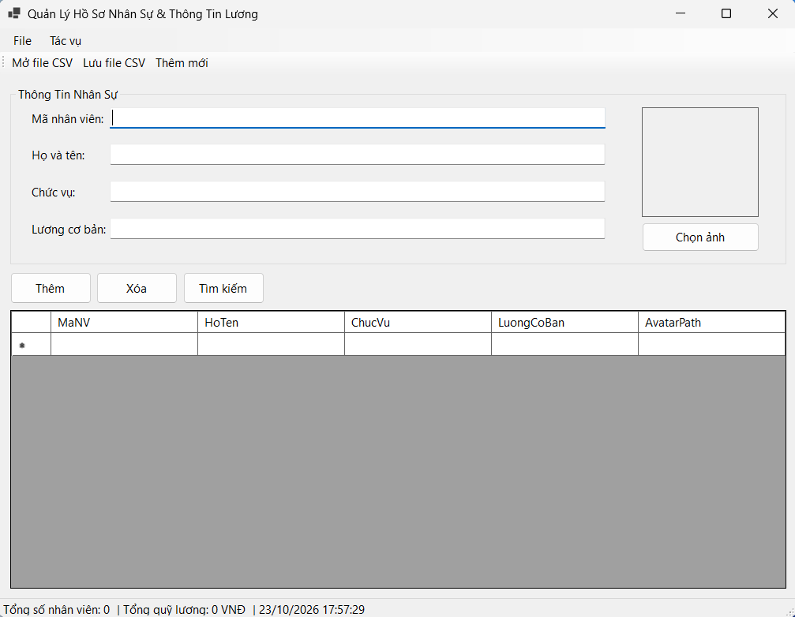
*Mô tả: Giao diện chính với MenuStrip, ToolStrip và StatusStrip thời gian thực.*

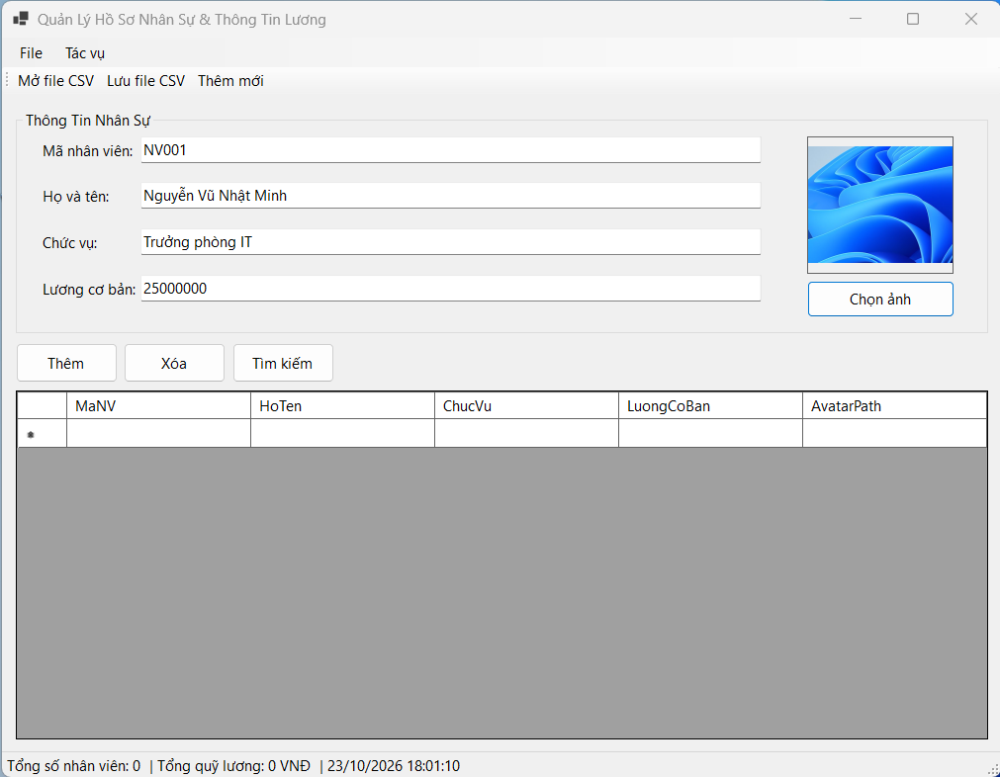
*Mô tả: Mở OpenFileDialog để duyệt và nạp ảnh chân dung nhân viên lên PictureBox.*

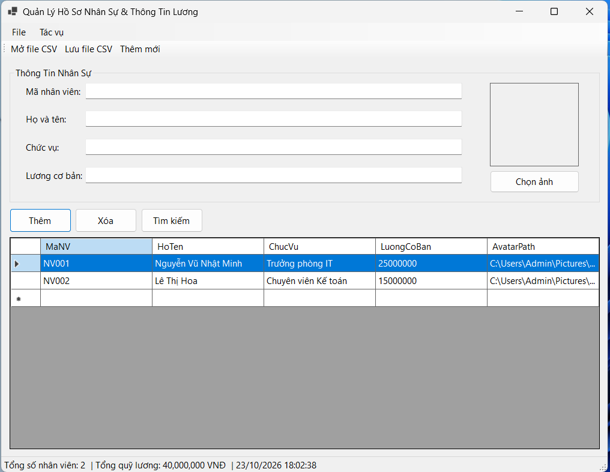
*Mô tả: Thanh StatusStrip tự động tính toán tổng số lượng nhân sự và tổng quỹ lương.*

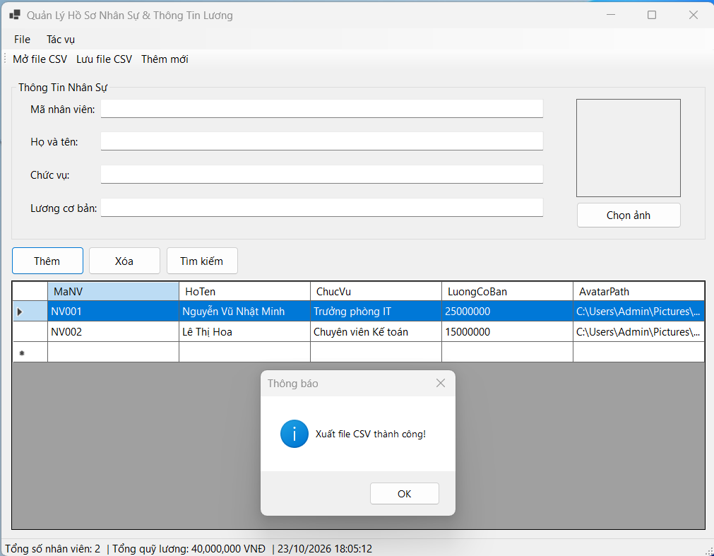
*Mô tả: Xuất toàn bộ danh sách nhân sự ra file CSV bằng SaveFileDialog.*

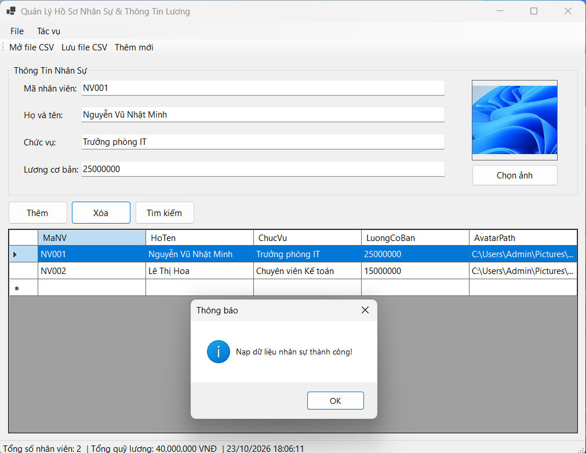
*Mô tả: Đọc file CSV từ đĩa cứng và nạp ngược dữ liệu vào BindingList.*

---

### 3. Bài 3: Hệ Thống MDI Quản Lý Trường Học & Đào Tạo
- **Kỹ thuật áp dụng:** Khung giao diện Form cha MDI (`IsMdiContainer = true`), quản lý và kích hoạt Form con tránh mở trùng lặp (`Activate()`), điều hướng cửa sổ dạng Xếp tầng (`Cascade`) và Xếp ngang/dọc (`Tile`).
- **Hình ảnh minh họa Giao diện:**

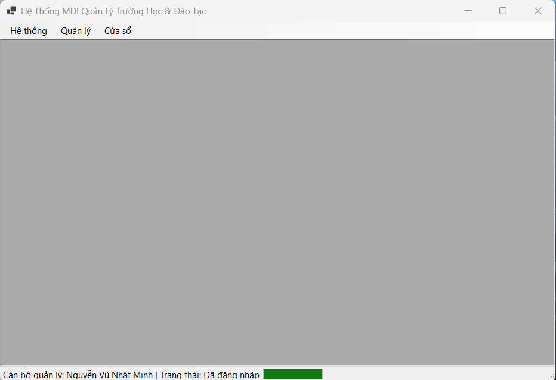
*Mô tả: Khung Form cha MDI sẵn sàng quản lý các cửa sổ con.*

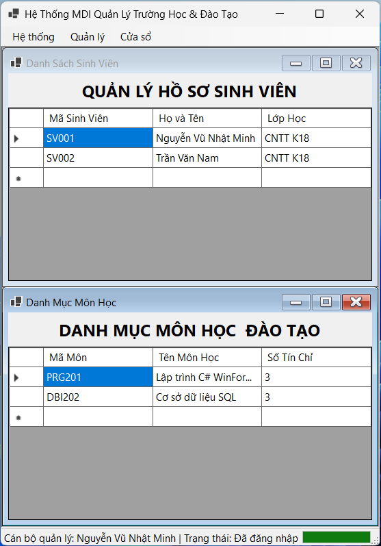
*Mô tả: Mở đồng thời cửa sổ Sinh viên và Cửa sổ Môn học trong vùng làm việc MDI.*

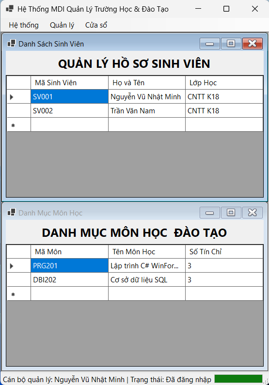
*Mô tả: Hệ thống tự động kích hoạt cửa sổ đang có thay vì mở thêm Form mới lặp lại.*

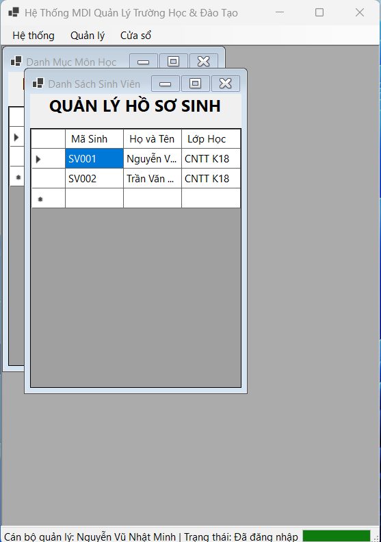
*Mô tả: Sắp xếp các cửa sổ con dạng xếp tầng (Cascade).*

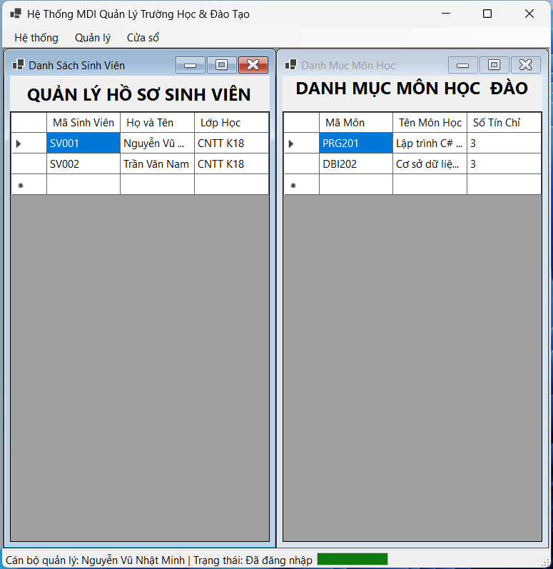
*Mô tả: Chia đều vùng làm việc cho các Form con dạng Tile Horizontal/Vertical.*

---

### 4. Bài 4: Thống Kê Kho Hàng (Async / Await & Cancellation)
- **Kỹ thuật áp dụng:** Lập trình bất đồng bộ `async/wait` để xử lý tác vụ tính toán dữ liệu kho hàng nặng mà không làm đơ giao diện UI, cập nhật tiến trình qua `IProgress<T>`, cho phép dừng tác vụ an toàn bằng `CancellationTokenSource`.
- **Hình ảnh minh họa Giao diện:**

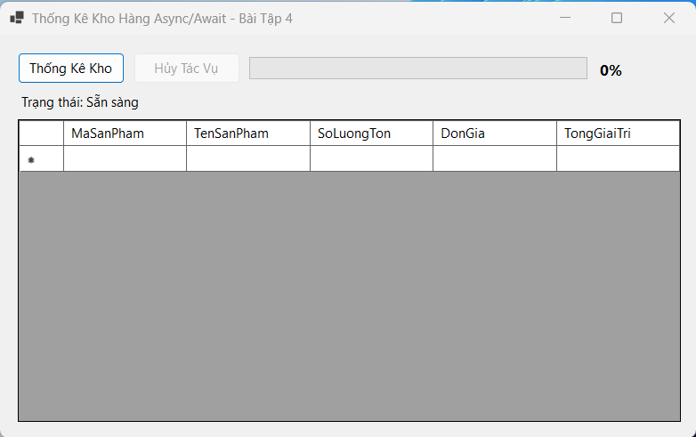
*Mô tả: Giao diện thống kê kho hàng sẵn sàng thực thi tác vụ.*

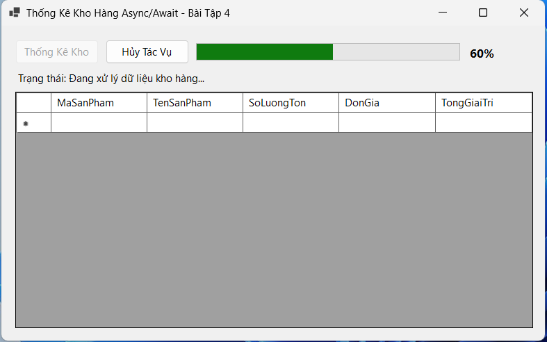
*Mô tả: Tiến trình chạy ngầm tăng % trên ProgressBar mà giao diện UI vẫn mượt mà.*

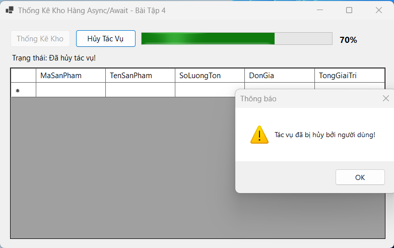
*Mô tả: Người dùng phát lệnh hủy tác vụ bằng CancellationTokenSource.*

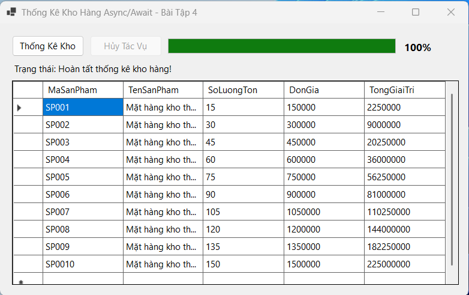
*Mô tả: Tiến trình đạt 100% và nạp toàn bộ danh mục tồn kho xuống DataGridView.*

---

### 5. Bài 5: Giám Sát Thiết Bị IoT Real-time (Cross-Thread Updates)
- **Kỹ thuật áp dụng:** Xử lý đa luồng (Multithreading), sinh dữ liệu cảm biến ngẫu nhiên từ luồng ngầm (`Task.Run`), cập nhật dữ liệu an toàn lên giao diện UI tránh lỗi Cross-Thread Violation bằng `this.Invoke()`, cảnh báo quá nhiệt đổi màu hiển thị Real-Time.
- **Hình ảnh minh họa Giao diện:**

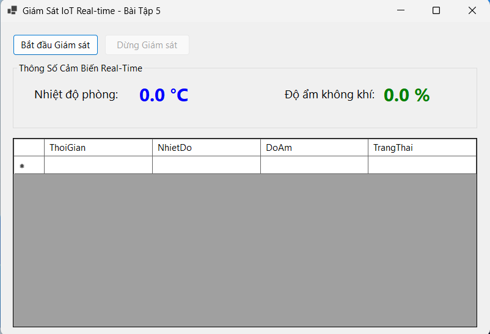
*Mô tả: Giao diện hệ thống giám sát cảm biến IoT real-time.*

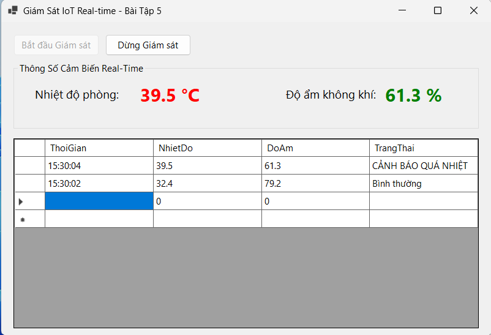
*Mô tả: Luồng ngầm liên tục cập nhật thông số nhiệt độ, độ ẩm và đẩy nhật ký thời gian thực.*

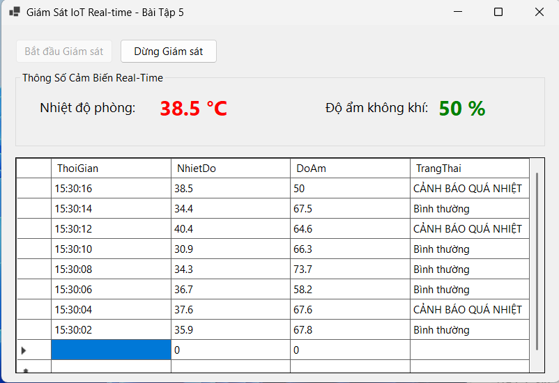
*Mô tả: Đổi màu hiển thị đỏ rực và ghi log "CẢNH BÁO QUÁ NHIỆT" khi nhiệt độ > 37°C.*

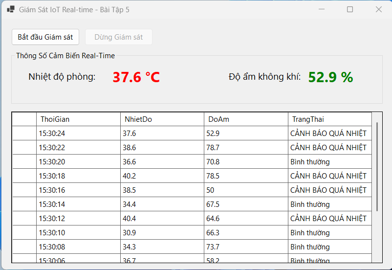
*Mô tả: Dừng luồng ngầm nhận dữ liệu và bảo đảm an toàn khi đóng ứng dụng.*

---
